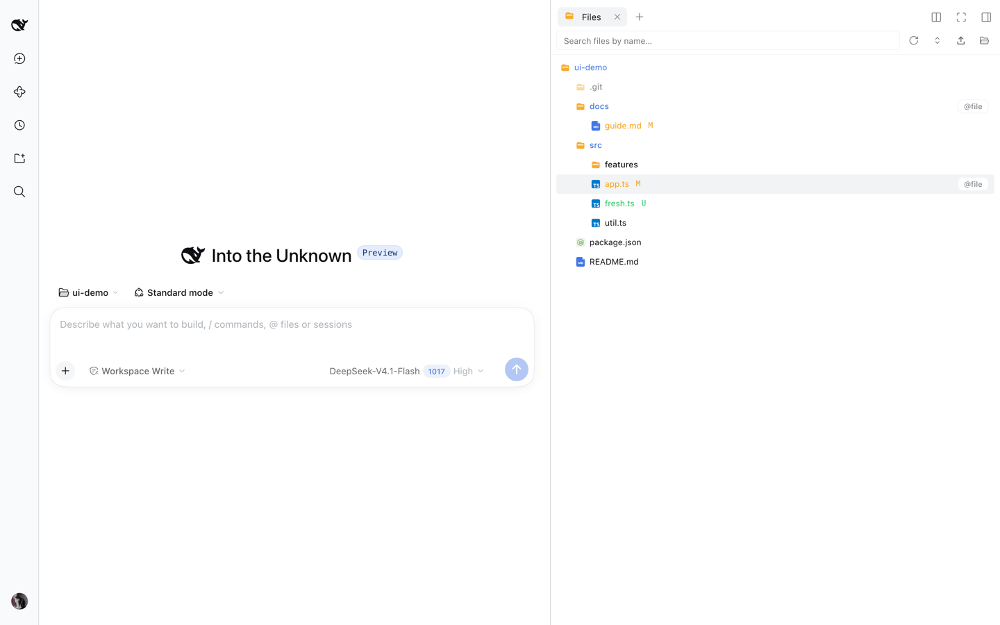
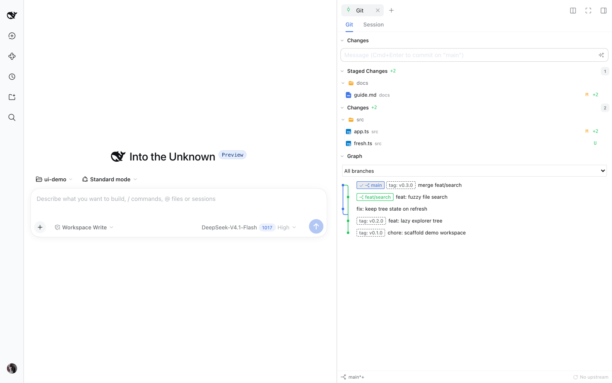

# dsh-better-sidebar

<div align="center">
  <b style="font-size: 1.15em;">DSH용 듀얼 워크벤치: 네이티브 오른쪽 사이드바 + 자체 렌더링 하단 패널, 그리고 모든 플러그인에 열려 있는 <code>ctx.betterSidebar</code> 서비스</b><br /><br />
  <a href="https://www.npmjs.com/package/dsh-better-sidebar"></a>
  <a href="https://www.npmjs.com/package/dsh-better-sidebar"></a>
  <a href="https://github.com/omdsh-dev/DSH-better-sidebar/actions/workflows/ci.yml"></a>
  <a href="https://github.com/omdsh-dev/DSH-better-sidebar/stargazers"></a>
  <a href="https://opensource.org/licenses/MIT"></a>
  <a href="https://www.npmjs.com/package/@deepseek-ai/dsh?activeTab=versions"></a>
</div>

<div align="center">
  🌏 <a href="./README_ZH.md">中文</a> · <a href="./README.md">English</a> · <a href="./README_KO.md"><b>한국어</b></a>
</div>

<div align="center">
  <video src="https://github.com/user-attachments/assets/23187822-047e-45cc-b480-fe997bd55b86" muted autoplay loop playsinline controls width="100%"></video>
</div>

## ✨ 기능

| | |
|---|---|
| **🗂️ 파일 관리**<br/>지연 로딩 트리, git 상태 색상, 실시간 디렉터리 감시, 전역 검색, 드래그 앤 드롭 업로드, 다중 선택 일괄 작업, 두 출처를 합친 "다음으로 열기" 메뉴.<br/><br/> | **🌿 Git**<br/>소스 제어(Merge / Staged / Changes 그룹, 생성 버튼이 있는 메시지 입력란, 브랜치 + 동기화 하단 바)와 이번 세션의 AI 변경 보기, 그리고 **읽기 전용 커밋 그래프**(레인, ref 배지, 브랜치 필터, 커밋 상세)를 한 탭에 담았습니다.<br/> |
| **📝 편집 가능한 에디터 & 미리보기**<br/>편집 가능한 CodeMirror(기본 미리보기는 읽기 전용), Markdown + Mermaid + 떠 있는 개요, 샌드박스 HTML 미리보기, `.jsonl` 레코드 카드, 대용량 파일 페이지 미리보기, 크기 제한 없는 스트리밍 전송.<br/> | **🧩 작업**<br/>실시간 서브 에이전트 토폴로지(워크플로 그래프 / 트리 모드) + 백그라운드 작업 목록: 종료 코드, 실시간 출력, 강제 종료.<br/> |
| **💬 사이드 채팅 (베타)**<br/>Codex 스타일의 사이드 스레드: 상위 컨텍스트 전체를 이어받아 독립적으로 실행, 실시간 푸시, 보이고 취소 가능한 대기열, 스레드별 모델 선택, 최상위 세션으로 원클릭 승격.<br/> | **🖥️ 하단 워크벤치**<br/>네이티브 오른쪽 사이드바와 공존하는 자체 렌더링 하단 패널: 드래그로 창 분할, 여러 터미널 탭, 세션별로 저장되는 레이아웃.<br/> |

**그 밖에**: 📂 `sidebar_open` 도구로 모델이 직접 사이드바를 열 수 있음 · ⚡ 시작 시 코어 약 325KB, 무거운 청크는 필요할 때 로드 · 🌏 i18n은 DSH 설정을 따름 · 📱 좁은 화면에서는 전체 폭 서랍으로 전환

### 🌿 Git Graph (읽기 전용 커밋 그래프)

Git 패널 상단에서 **Git Graph**로 전환하면 로컬 브랜치, 원격 추적 브랜치, HEAD에 걸친 커밋 노드와 분기·병합 선을 볼 수 있습니다. 브랜치 선택기는 히스토리만 필터링하며 **체크아웃이나 fetch는 절대 하지 않습니다**. 커밋은 한 줄로 표시되고(레인 선 + ref 배지 + 제목), 마우스를 올리면 작성자와 짧은 해시가, 선택하면 하단 창에 전체 메시지와 diff가 열립니다. 히스토리는 페이지 단위로 로드되고, 페이지를 넘기는 동안 ref가 바뀌면 새로 고침을 안내합니다. 읽기 범위에는 제한이 있으며(페이지당 커밋 200개, 오프셋 10,000, 브랜치 1,000개) 한도를 넘으면 명시적인 오류를 보여줍니다. 첫 버전은 태그를 표시하지 않으며 히스토리를 바꾸는 작업은 제공하지 않습니다.

### 🧭 dsh-context 진단 (선택)

`dsh-context` 플러그인이 설치되어 있으면 세 곳에서 해당 대화의 **Context** 보기로 바로 이동할 수 있습니다: 작업 페이지의 에이전트 노드 상세 카드, 백그라운드 작업 출력 창(행을 감시하던 세션이 아니라 작업의 실제 소유 세션), 세션 헤더. 이 진입점은 dsh-context의 `Context` 페이지가 실제로 등록되어 있을 때**만 나타납니다**. 해당 페이지가 없거나 숨겨진 배포에서는 아무 컨트롤도 보이지 않으며, 이동 중에는 모든 진입점이 비활성화됩니다. 이동에 실패하면 화면 하단에 닫을 수 있는 알림으로 한 번만 알리며, 유휴 상태에서는 아무것도 폴링하지 않습니다.

## 🚀 설치

```sh
dsh plugin --profile web add dsh-better-sidebar@latest
```

그다음 **브라우저를 강력 새로 고침**하세요(Cmd/Ctrl+Shift+R). DSH **0.2.1-rc.1+**가 필요합니다.

> **이 포크(DegreeCode)의 빌드를 설치하려면** [Releases](https://github.com/DegreeCode/dsh-better-sidebar/releases)에 첨부된 tarball을 쓰세요. `lib/`가 이미 빌드되어 있어 Git 주소로 설치할 때 나는 `ERR_PNPM_GIT_DEP_PREPARE_NOT_ALLOWED` 없이 설치됩니다.
>
> ```sh
> dsh plugin --profile web add https://github.com/DegreeCode/dsh-better-sidebar/releases/download/v0.28.1/dsh-better-sidebar-0.28.1.tgz
> ```

> **호환성 경고 — v0.28.0이 이 플러그인의 npm `latest`를 이어받습니다.** DSH 자체의 npm `latest`는 아직 **0.2.0-rc.2**를 가리키며, 이 버전은 v0.28.0과 **호환되지 않습니다**. 해당 호스트에서는 위 명령 대신 `dsh-better-sidebar@0.26.1`로 고정하세요. DSH 0.2.1-alpha.5 사용자는 `dsh-better-sidebar@0.28.0-alpha.0`으로 고정해야 합니다. v0.28.0을 설치하기 전에 호스트를 `0.2.1-rc.1`로 직접 업그레이드하세요. 두 패키지의 `latest` 태그는 서로 독립적입니다.

<details>
<summary><b>DSH 버전에 맞는 플러그인 버전 고르기</b></summary>

| 사용 중인 DSH 버전 | 설치 명령 |
| --- | --- |
| **0.2.1-rc.1+** | `dsh plugin --profile web add dsh-better-sidebar@0.28.0` |
| **0.2.1-alpha.5** | `dsh plugin --profile web add dsh-better-sidebar@0.28.0-alpha.0` |
| **0.2.0-rc.2** | `dsh plugin --profile web add dsh-better-sidebar@0.26.1` |
| **0.2.0-rc.1** | `dsh plugin --profile web add dsh-better-sidebar@0.24.1` |
| **0.1.7-rc.1 ~ 0.1.7 정식** | `dsh plugin --profile web add dsh-better-sidebar@0.22.1` |
| 0.1.7-alpha.x | 호환되는 릴리스 없음 — 먼저 DSH를 rc.1로 업그레이드하세요 |
| 0.1.6 이하 (0.1.5 계열 포함) | `dsh plugin --profile web add dsh-better-sidebar@0.19.1` |

이전 릴리스는 항상 **정확한 버전**으로 고정하세요(`latest`는 새 정식 버전마다 앞으로 이동합니다). `web`은 사용하는 프로필 이름으로 바꾸세요.

</details>

<details>
<summary><b>다른 설치 방법</b></summary>

**DSH에게 설치 맡기기** — 아무 DSH 세션에 이 프롬프트를 붙여 넣으세요:

```text
dsh-better-sidebar 플러그인(DSH용 사이드바 워크벤치)을 설치해 줘:
1. DSH가 0.2.1-rc.1 이상인지 확인한 다음 dsh plugin --profile web add dsh-better-sidebar@0.28.0 을 실행해
2. 끝나면 브라우저를 강력 새로 고침(Cmd/Ctrl+Shift+R)하라고 알려 줘
실패하면 먼저 https://github.com/omdsh-dev/DSH-better-sidebar README의 FAQ 표를 확인해.
```

**한 줄 스크립트** — 이 저장소를 클론하고 `bash scripts/install.sh 0.28.0`을 실행하세요(macOS / Linux / Windows Git Bash; 네이티브 Windows는 `./scripts/install.ps1 -Version 0.28.0`). 설치와 번들 등록을 함께 처리합니다.

**업데이트**: 설치 명령을 다시 실행한 뒤 브라우저를 강력 새로 고침하면 됩니다.

</details>

<details>
<summary><b>FAQ</b></summary>

| 증상 | 원인 & 해결 |
|---|---|
| `Ignored build scripts` 오류 | pnpm 11이 전이 의존성의 빌드 스크립트를 차단했습니다. 프로필 디렉터리(`~/.dsh/profiles/web`)에서 `pnpm approve-builds`를 실행하세요 — 이 플러그인 자체에는 빌드 스크립트가 있는 의존성이 없습니다. |
| `minimum release age` / 24시간 미만 버전 | 릴리스된 지 24시간이 안 됐습니다. 24시간 기다리거나 다시 실행하세요(pnpm이 `minimumReleaseAgeExclude`를 자동으로 추가합니다). |
| "Profile directory not found" | `dsh web`을 한 번 실행해 `~/.dsh/profiles/web`을 초기화하세요. |
| 페이지에 **사이드바가 두 개** | 중복 마운트입니다. `~/.dsh/profiles/web/cordis.patch.yml`에서 예전 수동 마운트 줄(`- insert: ... better-sidebar ...`)을 지우세요. 이 패키지를 다른 id로 마운트하는 묶음 패키지는 자동으로 양보하므로 조치할 필요가 없습니다. |
| 업그레이드 후 설정값이 사라짐 | DSH 0.1.7부터 환경설정은 프로필 안의 이 플러그인 마운트 행(기본 항목 id `better-sidebar`)에 저장됩니다. 플러그인은 첫 시작 시 예전 `settings.yaml` 값을 한 번 옮겨 오며, 더 새로운 값은 절대 덮어쓰지 않습니다. |
| 터미널을 사용할 수 없음 | 터미널은 **DSH 자체**가 제공합니다(이 플러그인에는 PTY가 없습니다) — DSH 문서를 참고하세요. 하단 터미널에 "host provides no terminal capability"가 보이면 이 배포에 터미널 컨트롤러가 마운트되지 않은 것입니다. |
| `dsh: command not found` | 먼저 DSH를 설치하거나, `npx -y --package @deepseek-ai/dsh@0.2.1-rc.1 dsh plugin --profile web add dsh-better-sidebar@0.28.0`을 사용하세요. |

</details>

## 🆕 최근 업데이트

**v0.28.0 — DSH 0.2.1-rc.1+용 정식 플러그인 릴리스**

- DSH peer 하한 13개를 모두 `^0.2.1-rc.1`로 올림. alpha.0의 기능을 런타임 변경 없이 유지
- 업스트림 alpha.5 → rc.1 전체 트리 차이는 355개 파일이며 모두 `package.json`, 소스 변경 없음
- DSH의 `latest`가 아직 0.2.0-rc.2인 상태에서도 v0.28.0이 이 플러그인의 npm `latest`를 대체함. 이전 호스트는 위 표의 버전으로 고정해야 함
- RC 검증은 진행 중이며 [RC 적응 기록](./docs/plans/2026-10-17-dsh-0.2.1-rc.1-adaptation.md)을 참고하세요. 이전 alpha 테스트 수치는 RC 검증 근거가 아닙니다

**v0.28.0-alpha.0 (프리릴리스)**

- DSH **0.2.1-alpha.5+** 대응: HTTP/WS에 네이티브 Connection 승인을 사용하고, 폐기된 invariant companion과 의존성을 제거
- 파일, Git, 터미널, 새로 만든 사이드 채팅이 세션의 현재 작업 디렉터리를 따라감
- 커밋 그래프가 Git 패널의 남은 높이를 채우고 diff 미리보기와 창 크기에 맞춰 조정됨
- 에이전트 상세, 백그라운드 작업 출력 창, 세션 헤더의 선택적 dsh-context 진단 바로가기는 Context 항목이 있을 때만 나타남
- **DSH 0.2.0-rc.2 사용자는 npm에 게시된 v0.26.1을 유지하세요**. v0.27.0은 게시되지 않았습니다. `latest`가 아니라 위의 명시적 alpha 버전을 사용하세요
- 검증 기록: [DSH alpha.5 적응 기록](./docs/plans/2026-10-16-dsh-0.2.1-alpha.5-adaptation.md) (최신 dev 통합 이전이며 최종 릴리스 테스트 수치가 아님)

**v0.27.0** - 전체 릴리스 기록은 [Releases](https://github.com/omdsh-dev/DSH-better-sidebar/releases) · [CHANGELOG](./CHANGELOG_EN.md)

- **Git 페이지 재구성**: 소스 제어 그룹, 브랜치 필터가 있는 읽기 전용 커밋 그래프, 공유 커밋 상세 / 내용 / Diff 창
- **정확한 변경 추적**: staged/unstaged 개수 분리, 중첩 저장소 탐지, 세션 기준 경로, PTC 파일 작업, 롱 폴링
- **선택 위치 유지**: 선택한 파일이 밀려나고 불필요한 테두리가 그려지던 통합 회귀를 수정하고 실제 호스트 레이아웃 테스트를 추가
- **사이드 채팅**: 새 하위 세션이 상위 로그 전체를 복사하는 대신 가장 최근의 요약 압축본에서 시작

**v0.26.1** — 전체 릴리스 기록은 [Releases](https://github.com/omdsh-dev/DSH-better-sidebar/releases) · [CHANGELOG](./CHANGELOG_EN.md)

- ⚡ **"0.24에서는 괜찮다가 느려졌다"의 원인이던 상시 비용을 수정** (커뮤니티 제보: 사이드바를 오래 열어 두면 버벅이고, 턴이 쌓이면 DSH가 느려지며, 재시작하면 한동안 괜찮아짐. 아티팩트 단위 A/B로 v0.25.0이 경계임을 확인): 500 ms 타이머 두 개 모두 가시성에 따라 동작(호스트 오른쪽 패널 상태는 모듈 수준 공유 폴러 하나, 빈 세션 대체 화면은 실제로 렌더링될 때만 실행), 탭마다 돌던 5 s 세션 루트 폴링은 **세션당 하나, 보일 때만**으로 변경, 파일 트리 감시와 사이드 채팅 푸시는 숨겨지면 정지, `keepMounted`의 의미는 유지하되 모든 캐시/레지스트리에 상한을 둠, 호스트 cwd 해석기에 진행 중 요청 중복 제거와 3 s → 15 s TTL 추가
- 📊 실제 마운트 레인에서 측정(방문한 탭 4개, 15 s 유휴 구간): 활성 500 ms 타이머 **3 → 1**, 활성 5 s 타이머 **5 → 0**, `session.cwd` 요청 **15 → 0**, 히트 테스트 **1,620 → 0**, 강제 레이아웃 **5,190 → 30**

## 🔌 플러그인 생태계

`ctx.betterSidebar`는 모든 플러그인에 두 가지 확장 지점을 제공합니다 — `registerTab` / `registerFileViewer`. 내장된 탭 6개와 뷰어 4개도 똑같은 API를 사용합니다. GitHub 토픽 [`dsh-better-sidebar`](https://github.com/topics/dsh-better-sidebar)에는 이미 **30개 이상의 생태계 플러그인**이 있으며, 전체 연동 가이드는 **[docs/external-plugin-guide.md](./docs/external-plugin-guide.md)**에 있습니다.

```ts
import type {} from 'dsh-better-sidebar'  // ctx.betterSidebar 타입 병합을 트리거
export const inject = ['betterSidebar']
export function apply(ctx: Context) {
  ctx.effect(() => ctx.betterSidebar.registerTab({
    id: 'my-plugin:db', title: 'Database', component: ({ scope }) => <DbView sessionId={scope.sessionId} />,
  }))
}
```

<details>
<summary><b>생태계 목록 (탭 플러그인 28개 · 뷰어 플러그인 4개 · 확장 4개)</b></summary>

### 📑 탭 플러그인 (사이드바 페이지)

| 플러그인 | ⭐ | 설명 |
|---|---|---|
| [ChenRuoT/dsh-sidebar-qa](https://github.com/ChenRuoT/dsh-sidebar-qa) |  | 선택해서 질문하는 사이드 페이지: Codex 스타일 사이드 질문 / Claude Code `/btw` |
| [fuhefei/dsh-sentinel](https://github.com/fuhefei/dsh-sentinel) |  | 조건 기반 웨이크업 시스템: 파일 / 명령 / HTTP / 프로세스 / webhook 감시자가 에이전트를 깨움. 독 + 사이드바 분기 + 전역 대시보드 |
| [Fisfzy/ego-browser](https://github.com/Fisfzy/ego-browser) |  | 에이전트 브라우저: i18n을 지원하는 로컬 브라우저 탭 (better-sidebar가 있으면 사이드바 페이지를 자동 등록, 없으면 떠 있는 관찰 창으로 대체) |
| [jiuge2467/dsh-studio](https://github.com/jiuge2467/dsh-studio) |  | 풀스택 워크벤치: 다중 소스 MCP 시각 디버깅 허브, 시각적 사고 엔진 |
| [Iwctwbh/dsh-flowglass](https://github.com/Iwctwbh/dsh-flowglass) |  | Flowglass: 실시간 세션 흐름 시각화 (메시지 / 도구 그룹 / 서브 에이전트 분기) |
| [FeatherHunter/dsh-mattpocock-skills-deck](https://github.com/FeatherHunter/dsh-mattpocock-skills-deck) |  | 게임화된 mattpocock/skills 작업 시스템: 전장의 안개 지도, 작업 바 진행도 |
| [GULI-lab/DSH-element-source](https://github.com/GULI-lab/DSH-element-source) |  | UI 요소를 클릭하면 Vue / React / Svelte / Angular 소스로 이동하고 세션에 전달 |
| [Lzh3070/dsh-file-review-tab](https://github.com/Lzh3070/dsh-file-review-tab) |  | 파일 리뷰 페이지: 줄 단위 빨강/초록 diff + 되돌리기 + 채팅 줄로 가는 딥 링크 |
| [yq04/dsh-git-remotes](https://github.com/yq04/dsh-git-remotes) |  | Git 원격 페이지: 브랜치 / 업스트림 / ahead-behind, prune 포함 fetch, ff-only pull, 확인 후 push |
| [ztyhehe/dsh-better-sidebar-svn](https://github.com/ztyhehe/dsh-better-sidebar-svn) |  | SVN 소스 제어 페이지: status / diff / log / commit / update / revert / 충돌 해결, 내장 Git 패널과 대칭 |
| [Melody-max114/dsh-excel-panel](https://github.com/Melody-max114/dsh-excel-panel) |  | Excel 편집 페이지: xlsx 미리보기 / 편집, 실시간 수식 계산, 병합 셀, 원본 파일로 저장 |
| [v587d/dsh-anysearch-refs](https://github.com/v587d/dsh-anysearch-refs) |  | AnySearch 결과 참조 카드: 검색어, 출처 요약, 키워드 강조 |
| [Lukeknow0/dsh-markdown-link-preview](https://github.com/Lukeknow0/dsh-markdown-link-preview) |  | Markdown 산출물 링크 미리보기: 채팅의 동일 출처 `.md` 결과를 클릭해 사이드바에서 읽기 |
| [mlosun/dsh-docs-panel](https://github.com/mlosun/dsh-docs-panel) |  | 전역 문서 패널: 어느 워크스페이스에서나 읽을 수 있는 이식 가능한 Markdown 노트 |
| [tylina/dsh-tylina](https://github.com/tylina/dsh-tylina) |  | Typst 문서 도구: 논문, 보고서, 시험지, 이력서, 차트, 포스터, 악보, PPTX로 내보내는 슬라이드를 위한 WYSIWYG 조판 |
| [lnyuqian/dsh-skill-sidebar](https://github.com/lnyuqian/dsh-skill-sidebar) |  | 스킬 패널: 로컬 스킬 디렉터리 스캔, 짧은 동작 문구 + 원클릭 복사 + 고정 |
| [g-yixuan/dsh-sidenote](https://github.com/g-yixuan/dsh-sidenote) |  | Codex 스타일 사이드 채팅 + 선택 영역에 고정되는 주석 (가벼운 소비자 플러그인) |
| [OMSociety/dsh-ssh-tunnel](https://github.com/OMSociety/dsh-ssh-tunnel) |  | 다중 호스트 SSH 터널 + SSH 관리 페이지 |
| [OMSociety/dsh-git-forge](https://github.com/OMSociety/dsh-git-forge) |  | GitHub / Gitea 계정, 프로젝트 권한, push 정책 |
| [YesSanSan/dsh-conversation-outline](https://github.com/YesSanSan/dsh-conversation-outline) |  | 대화 개요 페이지: 턴 단위 구조 보기, 원클릭 이동, LLM 한 줄 제목 |
| [Wulabalabo/dsh-sidebar-Explorer-Plus](https://github.com/Wulabalabo/dsh-sidebar-Explorer-Plus) |  | 파일 관리 페이지: 업로드 / 이동 / 삭제 / 이름 바꾸기 / 새 폴더 (쓰기 작업) |
| [yq04/dsh-turn-review](https://github.com/yq04/dsh-turn-review) |  | 턴 리뷰: 에이전트 변경을 턴 단위로 검토 |
| [Ghz114514/dsh-refpics](https://github.com/Ghz114514/dsh-refpics) |  | Pinterest 스타일 참고 이미지 검색: 메이슨리 흐름, 사이드바 보드, 다운로드 & Eagle 즐겨찾기 |
| [yzlin499/dsh-yzlin499-easy-plugins](https://github.com/yzlin499/dsh-yzlin499-easy-plugins) |  | 간편 유틸리티 모음 (기본 DSH에도 친화적) |
| [dong-victor/dsh-better-sidebar-starter](https://github.com/dong-victor/dsh-better-sidebar-starter) |  | 실행 구성 페이지: IDEA 스타일 Run/Debug 구성 — 원클릭 시작, 기록, WebSocket 실시간 로그, 병렬 인스턴스 |
| [baosfeng/my-dsh-plugins](https://github.com/baosfeng/my-dsh-plugins) |  | 개인 플러그인 모음 (`dsh-file-activity`): 사이드바 파일 활동 페이지 — 읽기 / 생성 / 수정 기록과 통계 |
| [Hoemr/dsh-better-overleaf](https://github.com/Hoemr/dsh-better-overleaf) |  | Overleaf 탭: CDP 브라우저 로그인, 프로젝트 전환, 양방향 동기화되는 로컬 git 미러 |
| [Andor-Z/dsh-turn-outline](https://github.com/Andor-Z/dsh-turn-outline) |  | 턴 추적 페이지: 사용자 턴 단위로 세션을 접고, 단계를 클릭하면 채팅 위치로 이동. LLM 미사용, 읽기 전용 |

### 🖼️ 뷰어 플러그인 (파일 뷰어)

| 플러그인 | ⭐ | 설명 |
|---|---|---|
| [HuanLinOTO/dsh-plugin-better-sidebar-plugin-office](https://github.com/HuanLinOTO/dsh-plugin-better-sidebar-plugin-office) |  | Office 3종 미리보기 (.docx / .xlsx / .pptx), 별도의 가벼운 번들로 제공 |
| [HuanLinOTO/dsh-plugin-better-sidebar-plugin-audio](https://github.com/HuanLinOTO/dsh-plugin-better-sidebar-plugin-audio) |  | 오디오 미리보기: 확대 가능한 파형 플레이어 + 실시간 스펙트럼, HTTP Range 스트리밍 라우트, 크기와 관계없이 탐색 가능 |
| [zemul/dsh-video-preview](https://github.com/zemul/dsh-video-preview) |  | 인라인 동영상 미리보기: .mp4 / .webm / .mov / .mkv / .avi, HTTP Range 탐색 |
| [dong-victor/dsh-better-sidebar-jupyter](https://github.com/dong-victor/dsh-better-sidebar-jupyter) |  | 실행 가능한 `.ipynb` 노트북 보기: 지연 로딩 Python 커널, 스트리밍 출력, 원본 저장 |

### 🧰 확장 & 도구

| 플러그인 | ⭐ | 설명 |
|---|---|---|
| [eg-bole/dsh-better-sidebar-icons](https://github.com/eg-bole/dsh-better-sidebar-icons) |  | VSCode 스타일 파일 / 폴더 아이콘 테마 (vscode-icons 이식, 순수 DOM 오버레이, 비침투적) |
| [dong-victor/dsh-better-sidebar-terminal-plus](https://github.com/dong-victor/dsh-better-sidebar-terminal-plus) |  | 터미널 확장: Nerd Font 아이콘 내장, xterm 아이콘 렌더링 수정, 안정적인 터미널 cwd |
| [Max-Null/dsh-sidebar-preview-select](https://github.com/Max-Null/dsh-sidebar-preview-select) |  | 미리보기 선택 강화: 사이드바 미리보기에서 텍스트 선택 → 떠 있는 "세션으로 보내기" |
| [Hoemr/dsh-quicklook](https://github.com/Hoemr/dsh-quicklook) |  | QuickLook 스타일 Space 미리보기: 활성 파일 탭에서 Space를 누르면 이미지 / PDF / 텍스트를 원본 크기로 |

</details>

> 📣 **플러그인 등록하기**: 저장소에 `dsh-better-sidebar` 토픽을 달면 [토픽 페이지](https://github.com/topics/dsh-better-sidebar)에 나타납니다. 앱 내 추천 목록에 들어가려면 [`src/client/plugins-tabs.ts`](./src/client/plugins-tabs.ts) / [`plugins-viewers.ts`](./src/client/plugins-viewers.ts)에 `PluginEntry`를 추가하는 PR을 보내세요.

<details>
<summary><b>⌨️ 키보드 단축키</b></summary>

| 동작 | 키 |
|---|---|
| 에디터 저장 | `Ctrl/Cmd + S` |
| 파일 내 찾기 / 바꾸기 | `Ctrl/Cmd + F` |
| 다음 / 이전 찾기 | `Ctrl/Cmd + G` / `Shift + Ctrl/Cmd + G` |
| 다음 일치 항목 선택 | `Ctrl/Cmd + D` |
| Git 커밋 | `Ctrl + Enter` |
| 탭 닫기 | 가운데 클릭 |
| 창 분할 / 합치기 | 탭을 창 가장자리 / 가운데로 드래그 |
| 입력란에서 파일 참조 | 행에 마우스 올리기 → `@file` 버튼 |

</details>

<details>
<summary><b>🔐 보안 & ⚠️ 알려진 제한</b></summary>

- 라우트는 Host 헤더 신뢰 울타리 뒤에 있습니다(`/api`와 동일). `fs.write`는 원자적이며, git은 CLI로만 호출하고 신원(identity)을 설정하지 않습니다
- ⚠️ **v0.23.0부터 fs 라우트는 워크스페이스 범위 검사를 하지 않습니다**: 호스트 사용자가 접근할 수 있는 모든 경로를 읽고 쓸 수 있으므로(OS 권한만 적용) 호출자는 이 라우트를 격리된 것으로 취급하면 안 됩니다
- HTML 미리보기는 **불투명 출처 샌드박스 iframe**에서 렌더링됩니다. 설정에서 기능별로 샌드박스를 끌 수 있습니다(기본값 꺼짐, 경고 표시)
- Git 네트워크 작업은 패널의 **Push** / **Pull**(`git pull --ff-only`) 버튼뿐이며 누를 때만 실행됩니다. 백그라운드 fetch는 없습니다. 파일 트리는 **펼쳐진** 디렉터리만 감시합니다. Markdown 미리보기는 저장된 파일을 렌더링합니다
- 읽기 전용 형식(스프레드시트 / PDF / 이미지 / Office)은 DSH 자체 문서 미리보기로 렌더링되며 호스트 버전을 따릅니다. 브라우저 보기는 desktop 프로필에만 있습니다
- 저장하지 않은 초안은 탭 닫기 / 파일 삭제 / 새로 고침 전에 확인을 받습니다. 외부에서 수정된 뒤 저장하면 조용히 덮어쓰지 않고 거부합니다
- 모바일(<768px)에는 하단 패널이 없으며, 해당 탭은 오른쪽 사이드바의 전체 폭 서랍에 합쳐집니다

</details>

<details>
<summary><b>🛠️ 개발 & 빌드</b></summary>

```sh
pnpm install      # @deepseek-ai/* devDependencies는 게시되어 있어 바로 설치됨
pnpm typecheck && pnpm lint && pnpm build && pnpm test
make check        # 통합 게이트 (CI와 동일)
make mount        # 실제 마운트 스모크: build + pack → pnpm test:mount
```

**아키텍처**: host/client 두 부분으로 된 단일 npm 패키지 — host(`src/index.ts`): `/sidebar/api/*` JSON API, 미디어 / HTML 미리보기 / 업로드 라우트와 WebSocket 두 개. client(`src/client/index.tsx`): 네이티브 오른쪽 사이드바 탭 + 하단 워크벤치. 상태는 세션별로 localStorage에 저장됩니다. 저장소 규칙: [`AGENTS.md`](./AGENTS.md).

Windows / Linux / macOS 지원(macOS는 매일 검증, 나머지는 단위 테스트와 Windows CI로 확인). 네이티브 의존성이 없어 빌드에는 Node ≥ 20 + pnpm ≥ 10만 필요합니다.

</details>

## 💬 커뮤니티

QQ 그룹: 577011007

<div align="center">
  
  
</div>

## 🤝 기여하기

- **코드 변경은 PR로**: `feat/*` / `fix/*` 브랜치에서 개발 → `gh pr create`. 제출 전에 `pnpm typecheck && pnpm build && pnpm test`(또는 `make check`)를 실행하세요
- **생태계 플러그인 등록**: 저장소에 `dsh-better-sidebar` 토픽을 달고 [`src/client/plugins-tabs.ts`](./src/client/plugins-tabs.ts) / [`plugins-viewers.ts`](./src/client/plugins-viewers.ts)에 항목을 추가하는 PR을 보내세요
- 저장소 규칙: [`AGENTS.md`](./AGENTS.md)

## 👥 기여자

<a href="https://github.com/omdsh-dev/DSH-better-sidebar/graphs/contributors">
  
</a>

## 🔗 관련 프로젝트

- [dsh-tianshu-tui](https://github.com/huiliyi37/dsh-tianshu-tui): TDD와 증거 게이트 워크플로를 갖춘 DeepSeek Harness용 대화형 터미널 UI 플러그인
- [dsh-TUI](https://github.com/ccch1mneyyy/dsh-TUI): Claude Code 스타일 전체 화면 터미널 플러그인 — 픽셀 고래 헤더, 스트리밍 생각, 컨텍스트 진행 바 + TPS 게이지
- [dshfind 플러그인 스토어](https://dshfind.com/zh/plugins): 서드파티 플러그인 마켓 — `dsh-plugin` 토픽의 공개 저장소를 매일 동기화
- [DeepSeek Harness Desktop Tauri](https://github.com/hairyf/deepseek-harness-desktop): Tauri 데스크톱 빌드 — 5MB 설치 파일, 설정 불필요, 플러그인 사전 설치
- [DeepSeek Harness Desktop](https://github.com/anywhere-labs/deepseek-harness-desktop): 최신 데스크톱 앱 — Node.js 설정 없이 로컬 Harness 서비스를 시작하고 관리. [웹사이트](https://www.dshdesktop.cn)

---

<div align="center">
  <sub>MIT License · <a href="https://github.com/deepseek-ai/deepseek-harness">DeepSeek Harness</a> 생태계를 위해 제작 · <a href="https://github.com/topics/dsh-better-sidebar">topic dsh-better-sidebar</a>에서 더 많은 플러그인을 찾아보세요</sub>
</div>
